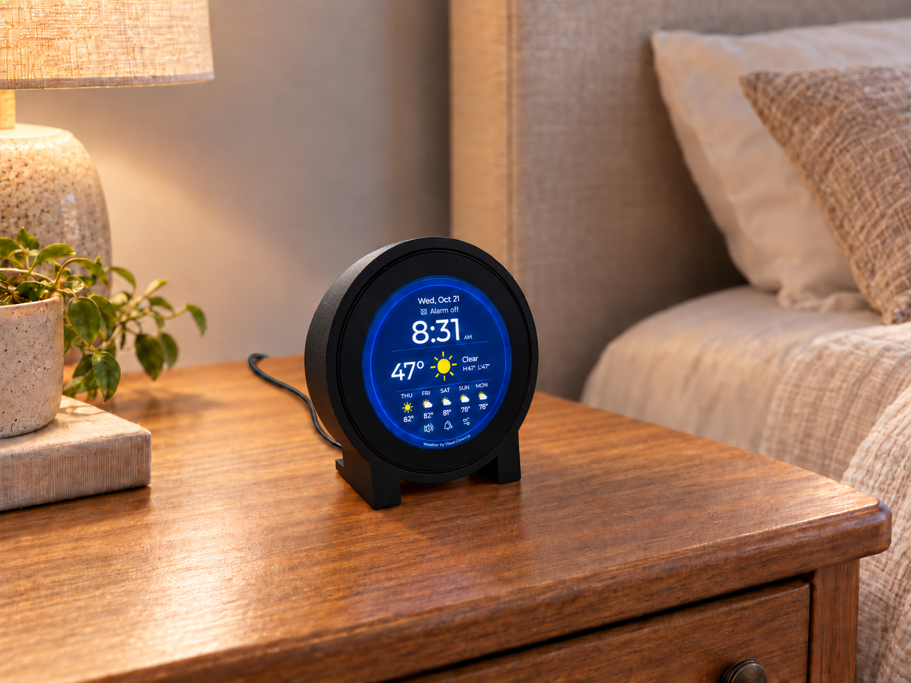
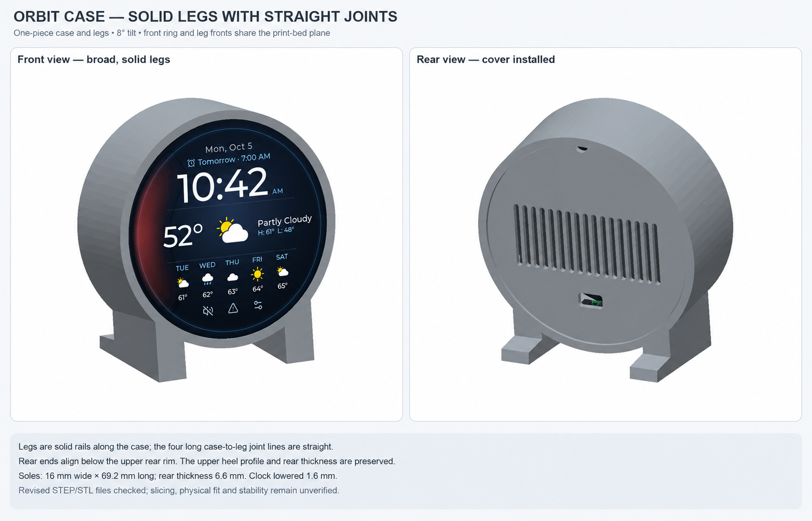
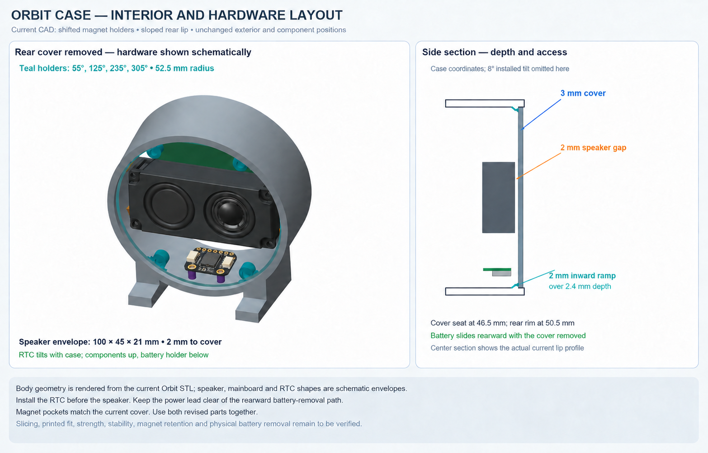

# ESP32 Weather Alarm Clock



ESP32 Weather Alarm Clock combines a bedside alarm, local weather, and a Sound Machine in a round touchscreen display for your nightstand or desk. The touchscreen interface includes analog and digital clock faces, weather forecasts, U.S. weather radar, official U.S. National Weather Service alerts, and household messaging.

Night Shift automatically adjusts the display for day and night, with sunset-to-sunrise scheduling and gradual brightness transitions. An optional battery-backed real-time clock keeps time through power interruptions.

The project is built on the **Waveshare ESP32-P4-WIFI6-Touch-LCD-3.4C** and was inspired by [Round Weather Display](https://github.com/Canterrain/round-weather-display) by Josh Hendrickson.

- [Features](#features)
- [Hardware](#hardware)
- [Orbit Case](#orbit-case)
- [Quick Start](#quick-start)
- [Using the Clock](#using-the-clock)
- [Household Messages](#household-messages)
- [Configuration](#configuration)
- [Documentation](#documentation)
- [License and Attribution](#license-and-attribution)

## Features

- Analog and digital clock faces, with 12-hour or 24-hour time and an optional leading zero in 12-hour mode.
- Large, centered digital time in Night Shift and a common unavailable-time screen for either clock face.
- Current temperature, today's high and low, and weather icons that change between day and night.
- A forecast for the next five days, with icons chosen to represent the daytime weather.
- A current radar map **for U.S. locations only**, centered on the saved location with a full-screen map covering a 75-mile diameter.
- Official National Weather Service watches and warnings **for the United States and NWS-covered territories and waters**, with on-clock headlines, warning/watch counts, and an alert list with event details.
- Weather from Open-Meteo without a key, or Visual Crossing with your API key.
- Time synchronized over Wi-Fi.
- DS3231 backup-clock support for startup while network synchronization proceeds, with lost-time and connection notices.
- A red Night Shift appearance with Off, Always On, Fixed Schedule or locally calculated Sunset to Sunrise preferences, remembered startup fallback, and separate Day/Night brightness with gradual transitions.
- Household messages sent from a phone or computer on the same network, with optional sharing among multiple ESP32-P4 clocks.
- Touchscreen settings for Wi-Fi, location, display, messaging and saved alarm/night preferences.
- One alarm with one-time or selected repeat days, Snooze, Slide to Dismiss while ringing, missed-alarm notices and restart recovery.
- Classic Beep, Classic Bell, and Rising Tones, with a five-second sound preview and gradually increasing alarm volume.
- Sound Machine with nine repeating recordings, White/Pink/Brown Noise, independent volume and a sleep timer.
- Automatic startup when the board receives power.

The approved design is in [docs/architecture.md](docs/architecture.md). Open [docs/alarm-design.html](docs/alarm-design.html) in a browser to explore the clock screens and House Messages page.

## Hardware

### Required hardware and setup tools

| Item | What it is for |
| --- | --- |
| [Waveshare ESP32-P4-WIFI6-Touch-LCD-3.4C](https://www.amazon.com/dp/B0F9YP4DCS) | The board with its 3.4-inch, 800 × 800 round touchscreen and included speaker. |
| [USB-C **data** cable (USB-C to USB-C)](https://www.amazon.com/dp/B0CN645NJ3) | Connecting the board to a computer for installation and updates; the linked cable supports 480 Mbps data transfer. A charge-only cable cannot transfer firmware. |
| USB-C power source | Powering the clock during everyday use. |
| Computer with desktop Google Chrome | Installing prepared firmware through the browser. Git and ESP-IDF 5.5.5 are needed only for source builds. |
| Wi-Fi network with internet access | Weather updates and network time. |
| Phone or computer with a browser | Sending House Messages over the same local network. |

Waveshare's [hardware documentation](https://docs.waveshare.com/ESP32-P4-WIFI6-Touch-LCD-XC#hardware-description) identifies the USB power/flashing ports and board connectors.

### For backup time

| Item | What it is for |
| --- | --- |
| [Adafruit DS3231 Precision RTC — STEMMA QT, #5188](https://www.adafruit.com/product/5188) | Keeping time when the main board loses power. |
| [STEMMA QT / Qwiic JST SH 4-Pin Cable — 50 mm, #4399](https://www.adafruit.com/product/4399) | Connecting the Waveshare board's I2C port directly to the RTC's STEMMA QT connector. |
| CR1220 coin cell | Battery backup for the Adafruit RTC module; the module does not include the battery. |

### Connect the backup clock

Use the **STEMMA QT version of the Adafruit DS3231 (#5188)** and the 50 mm cable listed above. This is a direct plug-in connection; no soldering, adapter or separate power wires are needed.

1. Disconnect USB and any other main power from the Waveshare board.
2. Insert a **CR1220** into the holder on the back of the **RTC module**, with the battery's **+ face visible**. The battery belongs in the Adafruit module, not the Waveshare board's RTC battery connector. See [Adafruit's battery-fitting instructions](https://learn.adafruit.com/adafruit-ds3231-precision-rtc-breakout/assembly).
3. Plug one end of the **50 mm STEMMA QT / Qwiic cable** into the Waveshare board's **I2C port**, and the other into a **STEMMA QT connector on the DS3231 module**. Either end of this cable can go to either board. Align the keyed plugs with their sockets; do not force them.
4. Reconnect power and let the clock connect to Wi-Fi and synchronize its time. The firmware detects the RTC automatically and sets it from network time; there is no separate RTC time-setting step.

The [four-wire cable](https://www.adafruit.com/product/4399) carries power, ground, SDA (data) and SCL (clock) over the board's existing I2C bus. The [RTC connector guide](https://learn.adafruit.com/adafruit-ds3231-precision-rtc-breakout/pinouts) describes the module's connections.

A newly installed RTC may initially report **Backup Clock Lost Time**. Allow network time to synchronize, then dismiss the notice. If a backup-clock notice returns after restarting, see [Clock and backup-clock notices](#clock-and-backup-clock-notices).

The RTC battery keeps time; it does not power the display or sound an alarm while the main board is unplugged.

## Orbit Case

Orbit is a 3D-printed enclosure for the clock's round touchscreen, Waveshare board, speaker and optional DS3231 backup clock. The body and its two legs print as one piece, holding the display at an 8° backward tilt. The magnetic back cover features openings for sound and ventilation and lifts off for easy access to the electronics or to change the RTC battery.



*Front and rear views of the assembled case, with an illustrative Digital clock screen.*

Inside, the speaker mounts horizontally behind the display, with the optional backup-clock board below it. The view with the cover removed shows the component layout and mounting points; the side section shows their spacing between the display and rear cover.



*Interior layout and side section, showing the speaker and optional backup clock.*

### Drawings

The case drawings follow the CAD model. The electronics are shown as simplified illustrations. Open a sheet for its dimensions and construction details.

| View | Drawings |
| --- | --- |
| Exterior and legs | [Front and rear](docs/orbit-case/Orbit-Solid-Legs-Mockup.png) · [Side profile and print section](docs/orbit-case/Orbit-Solid-Legs-Detail.png) |
| Interior and cover | [Populated interior](docs/orbit-case/Orbit-Interior-Layout-Mockup.png) · [Installed cover and leg junction](docs/orbit-case/Orbit-Back-Cover-Installed-Mockup.png) |
| Cover attachment | [Rear attachment and magnet section](docs/orbit-case/Orbit-Back-Mount-Mockup.png) · [Magnet-pad dimensions](docs/orbit-case/Orbit-Magnet-Pad-Detail.png) |
| Access and printing | [Mounts and rear-leg clearance](docs/orbit-case/Orbit-Leg-Rear-Clearance-Detail.png) · [Print orientation and bed contact](docs/orbit-case/Orbit-Front-Down-Print-Orientation.png) |
| Revised details | [Sloped rear seating lip](docs/orbit-case/Orbit-Rear-Lip-Detail.png) · [Magnet positions and screwdriver access](docs/orbit-case/Orbit-Magnet-Access-Detail.png) |

### CAD and print files

Use the STEP files to edit the design and the STL files to print the body and back cover.

| File | Purpose |
| --- | --- |
| [Assembly STEP](docs/orbit-case/cad/Orbit-Case-Assembly.step) | Body and cover in their installed positions; hardware omitted. |
| [Main body STEP](docs/orbit-case/cad/Orbit-Case-Main-Body.step) | Editable body solid in installed coordinates. |
| [Back cover STEP](docs/orbit-case/cad/Orbit-Case-Back-Cover.step) | Editable cover solid in the same installed coordinates. |
| [Main body STL — front down](docs/orbit-case/cad/Orbit-Case-Main-Body-Front-Down.stl) | Front ring and leg fronts on the bed; rear opening upward. |
| [Back cover STL — inside face down](docs/orbit-case/cad/Orbit-Case-Back-Cover-Outer-Face-Up.stl) | Inside face on the bed, magnet pockets downward; used for the successful print below. |
| [Back cover STL — outer face down](docs/orbit-case/cad/Orbit-Case-Back-Cover-Outer-Face-Down.stl) | Alternate orientation: outside face on the bed, magnet pockets upward. |

Import STLs in **millimeters at 100% scale** and keep their supplied orientation. The body needs approximately **125 × 137.64 × 68.49 mm** of print space; the cover is 3 mm thick.

### Printing

A successful print used a **Bambu Lab X1C** with the main case **front down** and the back cover **inside down** (outer face up), using these custom settings:

| Category | Setting | Value |
| --- | --- | --- |
| Quality | Wall generator | Arachne |
| Quality | Initial layer flow ratio | 1.06 (optional) |
| Strength | Wall loops | 4 |
| Support | Enable support | Checked |
| Support | Support type | Tree (auto) |
| Support | Support style | Tree Hybrid |
| Support | On build plate only | Checked |

The optional **1.06 initial layer flow ratio** helps fill the lines on the front rim of the case; it is not required.

## Quick Start

Choose [Install from Chrome](#install-from-chrome) to use the prepared firmware, or [build from source](#build-from-source).

### Install from Chrome

Use **Google Chrome on a Windows, Mac, Linux or ChromeOS computer**. This method installs the firmware and all nine Sound Machine recordings without building the project.

1. Connect the Waveshare board's **USB** Type-C port to the computer with a **USB-C data cable**. Use the USB port rather than **USB TO UART**. Close any other application or browser tab connected to the board's USB port.
2. In Chrome, open the [ESP32 Weather Alarm Clock installer](https://sdupuie.github.io/esp32-weather-alarm-clock/).
3. Click **Connect** to open Chrome's serial-port chooser. Select the entry named **USB JTAG/serial debug unit**. Here are examples of the complete entry to look for:

   | Computer | Example entry in Chrome |
   | --- | --- |
   | Mac | `USB JTAG/serial debug unit (cu.usbmodem8331401)` |
   | Windows | `USB JTAG/serial debug unit (COM5)` or `USB Serial Device (COM5)` |
   | Linux | `USB JTAG/serial debug unit (ttyACM0)` |

   The numbers in parentheses will vary; the device name identifies the board. Windows may use **USB Serial Device** as shown above. If you are unsure which entry is the board, unplug and reconnect it and look for the entry that disappears and reappears. Select that entry and click **Connect** to confirm.
4. Choose **Install ESP32 Weather Alarm Clock**.
5. Leave **Erase device unchecked** to keep your Wi-Fi, weather API key and other saved settings. Check it only if you intend to delete all saved data and start over. Click **Next**, then confirm installation.
6. Keep the USB cable connected and the Chrome tab open until installation finishes. The board restarts automatically afterward.
7. Close the installer when finished. If you opened **Logs & Console**, use **Back**, then close the connection dialog to release the USB port.

If Chrome cannot open the serial port on Linux, follow [USB access on Linux](docs/build.md#usb-access-on-linux).

With retained settings, the clock should return using its existing configuration. For a first installation or after erasing saved data, [finish setup on the touchscreen](#finish-setup-on-the-touchscreen).

### Build from source

To build the firmware yourself, follow the [step-by-step source-build guide](docs/build.md). It covers downloading the project, setting up the tools on Mac, Windows or Linux, and building and installing the firmware.

### Finish setup on the touchscreen

1. Open **Wi-Fi** under Device Setup, select your network and enter its password. Tap **Save & Restart**. Use **Manual Network** if needed.
2. Open **Device Setup → Weather → Weather Location**, enter your location, such as `Cincinnati,OH,US` or `Paris,FR`, and tap **Save**. A successful lookup and save restarts the clock; errors retain the editor.
3. Allow time for network synchronization and the first weather update.
4. Open **Settings → Display Settings** to change the clock face, time format or brightness, then tap **Save** to apply without restarting. Other device preferences are under **Device Setup**; nested **Done** keeps your edits until **Save & Restart** applies them.

For firmware updates, repeat the [Chrome installation](#install-from-chrome) or rebuild and flash from source. To prepare updated files for the browser installer, see the [build guide](docs/build.md#prepare-browser-installation-files).

## Using the Clock

Your selected analog or digital face is the home screen.

| From | Gesture or control | What happens |
| --- | --- | --- |
| Clock | Swipe left | Open Forecast, then Radar with another left swipe for supported U.S. locations. |
| Forecast or Radar | Swipe right | Step back toward the clock. |
| Clock | Swipe right | Open Messages. |
| Messages | Swipe left | Return to the clock. |
| Clock | Swipe down | Open settings. |
| Clock | Tap the speaker icon | Open Sound Machine; Back returns to the clock. |
| Clock | Tap the alert triangle | Open the active-alert list. Tap an on-clock alert headline to dismiss it from both clock faces. |
| Clock | Tap the next-alarm or **Alarm off** notice | Open Alarm Settings; Back or Cancel returns to the clock. |
| Clock | Tap **Missed Alarm** | Dismiss the missed-alarm notice. |
| Clock | Tap the snoozed-alarm notice | Open the snooze countdown screen. |
| Clock | Tap the backup-clock warning triangle, when shown | Read the backup-clock notice and dismiss it after checking the problem. |
| Settings entry | Tap **Back** | Return to the clock after first-use location setup is complete. |
| Unread message | Tap the displayed message | Mark it read for this clock and return home after acknowledgment succeeds. |

### Weather and Forecast

Weather normally refreshes every ten minutes. Until the first successful update, the clock and Forecast show **Waiting for weather…** without sample readings. If a later update fails, the clock keeps the last available weather while retrying. The clock faces show its age, such as **Weather updated 2h ago**, or **Weather data stale** when the age cannot be trusted. Forecast uses **Weather data stale** above its main day heading. Clock-face weather details and their notices are hidden in Night appearance; Forecast remains available.

Forecast shows the next five provider-dated entries. Retained forecasts keep their original dates after a failed refresh. **Tomorrow** appears only when the clock can confirm that date is tomorrow.

Choose Open-Meteo or Visual Crossing under **Device Setup → Weather → Provider**. Location searches use Open-Meteo for either provider. See [Weather provider and API key](#weather-provider-and-api-key) for setup and key management.

### Radar

**Radar is available only for U.S. locations.** U.S. territories are not included. For other locations, the Radar screen is hidden but Forecast remains available.

Radar shows the latest [RainViewer](https://www.rainviewer.com/) frame, with smoothed precipitation edges, over a [USGS National Map](https://www.usgs.gov/programs/national-geospatial-program/national-map) background, with the map's printed town names, a marker at your saved weather location and the frame's local date/time. The key uses equal-width green, yellow and red sections labeled **Light**, **Moderate** and **Heavy**. These describe radar echo strength, not NWS alert severity. Radar checks for a newer frame every five minutes. An unsuccessful update keeps the previous image and marks it “Old”; before any image arrives it shows “Radar unavailable.” Tap **Play** above the key to play the six latest ten-minute frames once, aiming for 1.5 seconds per image. Playback stops on the newest image and shows Play again. The usual five-minute checks keep that still image current. A busy update can hold an image longer. Tap **Pause** to hold the displayed image; its timestamp says **Paused**. Play resumes with the next image, or finishes if already at the newest frame. Leaving Radar stops playback and returns to the latest still image. The control becomes available after history loads; fewer images may be available after a failed download. Six samples cover the latest hour, with fifty minutes between the oldest and newest timestamps. The fixed map has no zoom or panning controls.

### Weather alerts

**Weather alerts are limited to [NWS coverage](https://www.weather.gov/about/): the United States, its territories and covered waters.** The clock uses the [National Weather Service Alerts API](https://api.weather.gov/alerts) for the saved weather location. It does not obtain alerts from other countries' warning services. Selecting Visual Crossing instead of Open-Meteo does not expand alert coverage.

The clock keeps the weather-alert triangle visible. Red warning and yellow watch badges show active counts. When an eligible alert headline is displayed, tap its text to dismiss the headline on both clock faces. The active event remains in the alert list and counts.

Tap the triangle to open **Alerts**. The list includes all active watches and warnings in NWS priority order, including alerts whose clock headline was dismissed. Opening Alerts also dismisses the clock headlines for alerts already received and stops any playing weather-alert sound. Active events remain listed and counted. A new alert or increased danger can bring a headline back.

Select a row to read its affected area, issue/end times, description and protective instructions. A **question mark inside the clock's alert triangle** means an up-to-date alert check is unavailable or has not yet succeeded. The list explains checking, update/save failures or unsupported locations; retained alerts remain available. See [Weather-alert sounds](#weather-alert-sounds) to choose which alerts can sound.

### Alarm

Open **Settings → Alarm Settings** or tap the alarm notice on the clock. Choose the time, repeat days, sound, volume and snooze duration. Use **Done** to return from a nested editor, then **Save** on Alarm to apply those edits without restarting. **Preview Sound** plays the selected unsaved sound at the unsaved volume for about five seconds. **Stop Preview**, leaving the sound picker or a ringing alarm stops it.

Alarm's header **Back** and **Cancel** discard unsaved edits and return to the screen where you opened Alarm: the clock shortcut or Settings. A successful Alarm Save returns to Settings. The immediate On/Off switch is separate from these unsaved edits; see [Saving and canceling](#saving-and-canceling).

For a one-time alarm, choose **Repeat → None**, set the time and Save. If Alarm is Off, reopen Alarm and turn it On after saving those choices. It rings at the next occurrence of that time, today or tomorrow. Snooze works normally; Dismiss turns the alarm Off. Turn it On again to reuse the time for another one-time alarm. Restart recovery keeps the original scheduled date.

Repeat also offers **Every Day**, **Weekdays** and **Custom Days**. Custom Days lets you select individual weekdays. Use Done or Back to return through Repeat to Alarm, then Save to apply the selection. Cancel on Alarm discards it.

While the alarm rings, tap **SNOOZE**, or drag the left handle of **SLIDE TO DISMISS** to the right end and release. Tapping the track or releasing a short drag keeps it ringing. Dismissal shows **DISMISSED** briefly before returning to the clock. The snoozed screen keeps its tap **DISMISS** button.

Turning Alarm Off stops ringing and cancels a pending snooze. Turning it On after today's alarm time arms the next scheduled alarm. After a restart, an unhandled alarm no more than 30 minutes overdue rings when usable time returns; an older ordinary occurrence produces **Missed Alarm**. A saved snooze resumes its countdown, or rings if its deadline is no more than 30 minutes overdue; an older snooze is discarded. A completed or expired one-time alarm turns Off. The backup battery does not sound the alarm while main power is absent.

**Daylight-saving changes:** An alarm in a skipped or repeated local-time interval uses the UTC offset after the change. For example, a skipped 2:30 AM in a one-hour spring jump rings at 1:30 AM before the jump. A repeated fall time rings at its second occurrence.

### Night Shift

Open **Device Setup → Night Shift** and choose **Off**, **Always On**, **Fixed Schedule** or **Sunset to Sunrise**. Fixed Schedule uses your chosen start/end times. Sunset to Sunrise calculates those times locally from your saved weather location and usable clock time; it does not need a weather download each day.

The **Sunrise/Sunset Offsets** page shows tonight's start and tomorrow's end. Before/At/After choices and five-minute adjustments preview different times; they do not change the running schedule until you save Device Setup. Set separate Day and Night brightness under **Display Settings → Brightness**. Brightness changes gradually when the appearance changes, including startup.

When a scheduled mode cannot be calculated at startup, the clock uses its last saved appearance, or Day if none is available. If the required time or solar events become unavailable while running, it keeps its current appearance. See the [Night Shift rules](docs/architecture.md#night-shift) for calculation details and defaults.

**Low brightness:** The 20% setting can make the screen too dim to use its menus. Check that the display remains readable before saving a lower brightness.

### Sound Machine

Open **Settings → Sound Machine** or tap the speaker on either clock face. Choose from **Rain, Thunder, Ocean, Wind, Forest, Campfire, Stream, Night, Singing Bowl, White Noise, Pink Noise** and **Brown Noise**. The first nine are looping recordings; the three noises are generated continuously. Sleep Timer offers **Continuous**, **15**, **30**, **60** or **120 minutes**.

Choose a sound, volume and sleep timer, then tap **Play**. These choices save and apply immediately; **Back** and **Done** keep playback running. Changing the sound keeps the remaining time; changing the timer starts its full duration. Timed playback fades during its final 30 seconds. **Stop**, a ringing alarm or an alarm-sound preview ends playback. Press Play to start again. Weather-alert audio temporarily interrupts playback, then resumes it if the sleep timer has not expired. The timer continues during that interruption. After a restart, your choices remain saved and playback is Stopped. See the [playback rules](docs/architecture.md#sound-machine-playback) for details.

### Clock and backup-clock notices

| Notice | What it means |
| --- | --- |
| **Waiting for sync** | The backup clock supplied usable time, but internet time has not yet synchronized after startup. The clock and alarms can still run. |
| **Time unavailable** | No usable time is available yet. The clock waits before triggering alarms. |
| **Clock paused** | The displayed minute has stopped advancing while the display is still being updated. |
| **Backup Clock Lost Time / Check Battery** | The RTC reported that its time could not be trusted. Check its coin cell. |
| **Backup Clock Unavailable / Check Connection** | The clock could not access the RTC. Check its connection. |

The triangle opens either backup-clock notice. Dismiss acknowledges the notice; it does not repair the hardware. Internet synchronization can restore time without clearing an undismissed notice. The RTC is checked again on each startup.

**Settings storage unavailable** is a separate startup failure. The clock stops startup when it cannot load settings, rather than automatically erasing them.

## Household Messages

The clock serves a **House Messages** web page. Connect your phone or computer to the same local network and open:

```text
http://<clock-ip>/messages
```

Replace `<clock-ip>` with the address shown for the clock in your router's connected-device list. Opening `http://<clock-ip>/` also opens the messages page.

### Send and manage messages

1. Enter a message and, optionally, a sender name.
2. Choose a target clock or **All clocks**.
3. Select **Normal** or **Important** priority.
4. Optionally set an expiration date and time.
5. Tap **Send Message**.

An edge indicator shows unread messages; Important messages make it pulse. Swipe right from the clock to read them. Important messages appear before Normal messages, with newer messages first within each priority.

Tapping a message on the clock marks it read **for that clock**. The browser's **Deactivate** action makes it inactive for everyone. Expired messages stop appearing.

While dismissal is pending, the clock remains responsive and shows “Dismissing...”. It returns home after acknowledgment succeeds. Failure keeps the message visible with a retry prompt. Leaving the message screen prevents a later result from taking you back home.

The browser's **Active Messages** list shows all active, unexpired messages, including those sent to an individual clock. Messages remain in this list after a clock marks them read; use **Deactivate** to remove them for everyone.

### Share messages among clocks

For one clock, leave messaging in **Single** mode. For several ESP32-P4 clocks:

Open **Settings → Device Setup → Messaging**, then:

1. Put all clocks on the same local network.
2. Give each a recognizable room name, such as `Kitchen` or `Bedroom`.
3. Give each a **distinct device ID**, such as `kitchen-clock` or `bedroom-clock`.
4. Select **Shared**, tap **Done**, then **Save & Restart** on Device Setup for each clock.

Shared mode rejects the default `clock-esp32-p4` ID. The clocks find each other automatically and choose one to coordinate messages. You can open any participating clock's messages page and choose the target there. The network must allow local broadcast discovery; isolation between Wi-Fi clients can prevent sharing.

**Message retention:** Current messages are kept in memory. The store holds up to 16 messages; when full, a new message replaces the oldest, even if it is still active or Important. Do not rely on them surviving a restart or loss of power; there is no persistent message archive.

## Configuration

Swipe down from the clock to open settings. Saved preferences stay on the device across restarts; there is no user-editable settings file to maintain.

| Menu | What you can change |
| --- | --- |
| **Display Settings** | Home Screen (**Analog** or **Digital**), **12-Hour** or **24-Hour** time, Leading Zero and Day/Night Brightness. |
| **Device Setup → Wi-Fi** | Scan for a nearby network or enter its name and password manually. |
| **Device Setup → Weather** | Weather Location, Provider/API key, Alerts and **Imperial** or **Metric** units. The location also sets the clock's timezone. |
| **Device Setup → Messaging** | Room Name, Device ID and **Single**/**Shared** House Messages. See [sharing setup](#share-messages-among-clocks). |
| **Device Setup → Night Shift** | Mode, fixed schedule and solar offsets with calculated start/end times. See [Night Shift](#night-shift). |
| **Alarm Settings** | On/Off, time, repeat days, sound, volume and snooze duration. The editor previews the next alarm for unsaved time/day edits. See [Alarm](#alarm). |
| **Sound Machine** | Sound, independent volume, sleep timer and Play/Stop. See [Sound Machine](#sound-machine). |

**Leading Zero** controls whether 12-hour time displays `07:00 AM` or `7:00 AM`. In 24-hour mode it shows On and cannot be changed. Returning to 12-hour mode restores the previous choice. Radar frame timestamps also use the saved time format, including when an older image is retained after a failed update.

Tap a text field to open the keyboard. The active input stays visible above it; Done or Close returns to the menu with your unsaved text. Passwords and API keys are masked. Weather Location accepts `City, State`, optionally followed by a country code, such as `Cincinnati,OH,US`. For a city and country without a state, use `Paris,FR`.

Alarm Time and Fixed Schedule minute arrows move in five-minute steps and change the hour when minutes wrap. Opening an editor leaves its saved time unchanged. Alarm volume, Sound Machine volume and Day/Night brightness sliders adjust in 5% steps. Brightness ranges from 20–100%.

### Saving and canceling

**Done** in a nested settings editor normally keeps your edits pending in its parent; it does not save them. Use the parent Save action below. Back from Provider or an alert-sound selection page discards that child's changes; use Done to retain them. Sound Machine is the immediate-control exception.

| Controls | How changes are applied |
| --- | --- |
| **Display Settings** | **Save** applies its five display choices without restarting and returns to Settings. **Back** or **Cancel** discards those edits. |
| **Device Setup**, including Wi-Fi, Messaging and Night Shift | **Save & Restart** applies these choices and restarts. **Cancel** on Device Setup discards its unsaved changes. |
| **Weather**, including Provider and Alerts | **Save** applies only Weather choices and restarts. **Back** or **Cancel** returns to Device Setup; its other pending edits are retained. |
| **Alarm Settings** | **Save** applies time, repeat, sound, volume and snooze choices without restarting. **Back** or **Cancel** discards unsaved edits. |
| **Alarm On/Off** | Saves and applies immediately, independently of pending alarm edits. **Back** or **Cancel** does not undo a successful switch change. |
| **Sound Machine** | Sound, volume and timer choices save and apply immediately. **Back** and **Done** only navigate. |

A failed save leaves the editor available for correction or retry and does not restart. If power is interrupted during saving, some stored settings may change while others retain their previous values; check the settings after restarting and save again if needed. The [architecture](docs/architecture.md#editing-and-saving-user-settings) defines the complete save rules.

### Weather provider and API key

Open **Device Setup → Weather → Provider** and choose **Open-Meteo** (no key required) or **Visual Crossing** (your API key required). API Key is inside the Visual Crossing Provider editor, rather than a separate Weather row.

Visual Crossing's API key stays masked. **Configured** means a key is saved; **Entered (not saved)** means you changed it in the editor. Save checks a newly selected Visual Crossing provider or changed key before applying it. If the check fails, the editor stays open for retry without restarting. Choosing Open-Meteo keeps the saved key for later reuse. To remove it, open API Key while Visual Crossing is selected, tap **Clear**, close the keyboard, choose Open-Meteo and Save. Cancel discards unsaved key changes.

If Visual Crossing confirms that the key's daily allowance is exhausted, the clock keeps its last weather and waits for the provider's retry time, or checks once an hour when none is supplied. You can choose another provider yourself.

### Weather-alert sounds

Open **Device Setup → Weather → Alerts** to choose which alerts can sound. Alerts use two separate sound catalogs: NWS watches and weather warnings. Watch Sounds offers **Off**, **All watches** or individual watches; Warning Sounds offers **Off**, **All warnings** or individual warnings. Their defaults are Off for watches and All warnings for warnings. **Alert Update Sounds** offers Off, Increased danger only or All updates and defaults to Off. **Night Alert Sounds** defaults to Off. These choices use the alarm volume; there is no separate alert-volume control. The Weather screen's Alerts summary describes the selected watch/warning sounds; **Silent** means sounds are off, not that visual alerts are disabled. See the [approved weather-alert behavior](docs/architecture.md#nws-watches-and-warnings) for the full rules.

## Documentation

See the [firmware setup and update guide](docs/build.md) for detailed installation instructions and the [approved design](docs/architecture.md) for product behavior. The [weather mapping reference](docs/weather.md) shows our icons, both providers' mappings and source limitations.

## License and attribution

This project is licensed under the [Creative Commons Attribution-NonCommercial 4.0 International License](https://creativecommons.org/licenses/by-nc/4.0/).

Original project © 2025 Josh Hendrickson, as recorded in the [license](license). [Author](https://anoraker.com). The original project credits [MagicMirror](https://github.com/MagicMirrorOrg/MagicMirror) as inspiration.

### Interface icons

Interface icons are adapted from [Lucide 1.17.0](https://github.com/lucide-icons/lucide/tree/1.17.0), including its Feather-derived designs. Their ISC and MIT copyright and permission notices are included in the [license file](license).

### Weather, location and map sources

- **Weather data provided by [Open-Meteo](https://open-meteo.com/)** — the default forecast and current-weather source. API data is provided under [CC BY 4.0](https://creativecommons.org/licenses/by/4.0/); access to its free service follows the [Open-Meteo terms](https://open-meteo.com/en/terms).
- **Weather data provided by [Visual Crossing Weather](https://www.visualcrossing.com/)** — the optional keyed forecast and current-weather source, under its [weather data license](https://www.visualcrossing.com/weather-service-terms/) and [attribution guidance](https://www.visualcrossing.com/resources/documentation/weather-data/how-to-properly-cite-or-attribute-visual-crossing-weather-data/).
- **Official watches and weather warnings by the [National Weather Service](https://api.weather.gov/alerts)** — active alerts for the clock's saved weather location.
- **Location data by [GeoNames](https://www.geonames.org/), via [Open-Meteo geocoding](https://open-meteo.com/en/docs/geocoding-api#attribution)** — place names, coordinates and timezones used by location setup, including when Visual Crossing supplies the weather. GeoNames data is [CC BY 4.0](https://creativecommons.org/licenses/by/4.0/).
- **Radar data by [RainViewer](https://www.rainviewer.com/)** — latest radar overlays, recolored for the clock's green/yellow/red key. See the [RainViewer API terms](https://www.rainviewer.com/api.html).
- **Map services and data available from U.S. Geological Survey, National Geospatial Program.** The Radar background uses USGSTopo from [The National Map](https://www.usgs.gov/programs/national-geospatial-program/national-map). These map services and data are [public domain](https://www.usgs.gov/faqs/what-are-terms-uselicensing-map-services-and-data-national-map); the clock adjusts their brightness for its display.

The clock converts provider units, selects representative forecast pictures and creates its own weather captions. These changes do not imply endorsement by the data providers. External data, libraries and assets retain their own licenses; the project's license does not replace them.

### Sound sources

Sound Machine recordings and the White, Pink and Brown Noise calculations were adapted from [soundmachine.app](https://soundmachine.app/). The clock's recordings have prepared loop crossfades and playback gain adjustments; generated noises use the source equations with the clock's output gain.
