# Weather condition mappings

Revised October 18, 2026.

This document owns the detailed condition-to-icon mappings for Open-Meteo and Visual Crossing. The [architecture](architecture.md#weather) owns location, measurements, refreshes, [quota recovery](architecture.md#visual-crossing-quota-recovery), stale-data presentation and existing warning rules. [Development work](work.md) records implementation and verification.

**Status: approved October 13, 2026 and implemented.** Every listed provider input has a defined treatment, including shared pictures, unused conditions and unknown inputs. Open-Meteo remains the default; Visual Crossing is the keyed alternative. The approved [daily forecast policy](#five-day-forecasts) reuses the current selection method for both providers with a 50% probability and 1.5 mm precipitation requirement for ordinary Rain/Showers, the [two-report Hail and Rain & Snow majority rules](#additional-daily-pictures), and current-only Ice, Wind and Funnel/Tornado pictures. Delivery evidence and remaining verification limits, including rare live provider IDs and real quota exhaustion, belong in [work.md](work.md#sprint-visual-crossing-and-approved-weather-mappings--authorized-october-13-2026).

The approved mappings convert both providers into our shared conditions, our own icons and our own current-condition wording. Provider-specific decoding is required; Visual Crossing does not need to be converted into invented Open-Meteo codes. The five-day screen shows icons and temperatures, without condition captions.

## Reading the table

- Open-Meteo numbers are its numeric weather codes. Visual Crossing numbers mean `type_<number>` in `conditions`, requested with `lang=id`. Split and trim all returned IDs; a response can contain several.
- Visual Crossing's quoted icon names are `icon` values requested with `iconSet=icons2`. `preciptype` is an array: retain every value. Specific reported freezing, mixed or hail evidence takes precedence over a broader provider icon.
- **Direct** means the source explicitly identifies the condition family. **Shared artwork** retains the source distinction in our caption while reusing a picture. **Derived** combines evidence from the same short reporting period. **Approximation** uses the nearest existing picture with an accurate caption. **Unused** means neither provider supplies the precise condition needed to select that picture; it is a defined outcome, not an open mapping decision.
- All Visual Crossing native-ID assignments are conditional on the ID being returned. Its published dictionary is not a confirmed list of conditions emitted in current reports or forecasts. Availability of rare conditions still needs real-response verification. See the [provider's explanation](https://www.visualcrossing.com/resources/documentation/weather-api/weather-condition-fields/).
- The 64px images in [weather-icons/](weather-icons/) show the selected artwork on a dark background. Preserve those approved drawings when converting formats; do not substitute simplified redraws. The previews are not runtime assets. Fog's original SVG is kept in the existing shared icon path; the five added drawings' exact SVG markup is kept in the existing `build_weather_icon()` generator.

## Complete mapping table

The table covers all 29 currently documented Open-Meteo weather codes, all 43 listed Visual Crossing native IDs and all 16 documented `icons2` identifiers. Compound rows preserve other reported facts even when only one picture is displayed.

| Condition | Our icon | Open-Meteo | Visual Crossing | Status |
|---|---|---|---|---|
| Clear, day/night |   Clear day / night | `0` | `43`; `clear-day`, `clear-night` | Direct; existing artwork |
| Mostly Sunny / Mostly Clear | 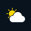 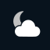 Partly cloudy day / night | `1`; retain the day/night caption distinction | No distinct native equivalent; `42` remains Partly Cloudy | Shared artwork; Open-Meteo distinction retained |
| Partly Cloudy, day/night |   Partly cloudy day / night | `2` | `42`; `partly-cloudy-day`, `partly-cloudy-night` | Direct; existing artwork |
| Cloudy | 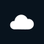 Cloudy | `3` | `41`; `cloudy` | Direct; existing artwork |
| Fog / Freezing Fog / Mist | 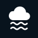 Fog | `45`, `48`; keep the freezing/rime distinction for `48` | `8`, `12`, `19`; `fog` | Shared artwork; existing Fog asset revised to two waves |
| Drizzle | 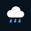 Rain | `51`, `53`, `55` | `2`, `3`, `4` | Shared artwork; current drizzle uses Rain |
| Rain / Drizzle and Rain |  Rain | `61`, `63`, `65` | `5`, `6`, `21`, `25`, `26`; `rain` or rain type, unless explicitly refined to Showers | Direct / shared artwork; preserve intensity or combined wording when known |
| Showers, day/night | 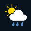 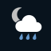 Showers day / night | `80`, `81`, `82` | `24`; `showers-day`, `showers-night` | Direct; requires explicit shower evidence |
| Freezing Rain / Freezing Drizzle | 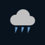 Blue angled icicles | `56`, `57` are freezing drizzle; `66`, `67` are freezing rain | `9`, `10`, `11`, `13`, `14`; `preciptype` includes `freezingrain` | Shared artwork. IDs `9`–`11` combine drizzle/rain, so retain broad Freezing wording when ambiguous |
| Rain & Snow | 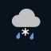 Existing rain-and-snow artwork | Derived from positive liquid rain/showers and snowfall in the same interval | `22`, `23`, `32`; otherwise same-record rain and snow evidence | Direct / derived; reuses existing `sleet.svg` artwork |
| Snow | 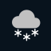 Snow | `71`, `73`, `75` | `31`, `34`, `35`; `snow` or snow type | Direct; existing artwork |
| Snow Showers |  Snow | `85`, `86` | `33`; `snow-showers-day`, `snow-showers-night` | Shared artwork; retain Snow Showers caption |
| Snow Grains |  Snow | `77` | No distinct native equivalent | Shared artwork; does not establish Sleet or falling snow for a compound condition |
| Blowing / Drifting Snow |  Snow | No direct code | `1` | Shared artwork; retain Blowing Snow caption. Does not alone establish falling snow |
| Diamond Dust / Ice Crystals |  Snow | No direct code | `39` | Shared artwork; retain Diamond Dust / Ice Crystals caption. Does not alone establish falling snow |
| Hail | 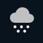 Larger white pellets | `96`, `99` report hail with thunder | `16`, `40` | Direct when reported; within one record, Hail picture wins over Thunderstorm while retaining thunder |
| Thunderstorm | 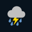 Thunderstorm | `95`, `97`; `96`, `99` also retain thunder when Hail supplies the picture | `37`, `38`; `thunder-rain`, `thunder-showers-day`, `thunder-showers-night` | Direct; recognition of `97` includes the existing thunder warning. `38` does not imply rain |
| Lightning Without Thunder |  Thunderstorm artwork | No separate code | `18` | Approximation for current and forecast pictures; current caption Lightning. Do not invent thunder or rain |
| Thundersnow | 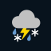 Thundersnow | Derived from thunder and falling-snow evidence in the same interval | Same-record thunder and falling-snow evidence; no dedicated native ID | Derived; require same-period evidence |
| Sleet / Ice Pellets | 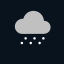 Two rows of small white pellets | No direct ice-pellet code; `77` remains Snow Grains | No precise supported pairing; `17` and `preciptype=ice` map to Generic Ice | **Unused by these providers**; do not manufacture a Sleet classification |
| Generic Ice |  Large standalone white snowflake | No direct code | `17`; `preciptype` includes `ice` | Direct generic category; precise subtype deliberately unspecified. Current conditions only |
| Wind / Squalls |  Three white gusts | No direct code; do not add a wind-speed threshold in this mapping | `36`; `wind` | Direct; retain Squalls caption for `36`. Current conditions only |
| Funnel Cloud / Tornado |  Four gray funnel bands | No direct code | `15` | Direct combined category; keep the combined caption without claiming a confirmed tornado. Current conditions only |
| Dust Storm |  Fog artwork | No direct code | `7` | Approximation; retain Dust Storm caption |
| Smoke / Haze |  Fog artwork | No direct code | `30` | Approximation; retain Smoke / Haze caption |
| Precipitation in Vicinity | Recognized accompanying local-weather icon; otherwise no picture | No direct code | `20` | No dedicated assignment; nearby precipitation does not establish a local type or amount |
| Sky coverage decreasing / increasing / unchanged | Recognized sky icon or actual cloud-coverage evidence; otherwise no picture | No direct code | `27`, `28`, `29` | No dedicated assignment; a trend does not establish cloud amount |
| Unknown / missing / new condition | Recognized accompanying evidence first; otherwise no picture | Unrecognized code | Unrecognized ID, icon or precipitation type | Defined fallback; current caption Unknown. Keep valid dates and temperatures |

Provider definitions: [Open-Meteo weather codes](https://open-meteo.com/en/docs#weather_variable_documentation), [Visual Crossing's linked English dictionary](https://docs.google.com/spreadsheets/d/1cc-jQIap7ZToVaEgiXEk_Aa6YVYjSObLV9PMe4oHrFg/edit#gid=1769797687), [Visual Crossing icon identifiers](https://www.visualcrossing.com/resources/documentation/weather-api/defining-icon-set-in-the-weather-api/), and [precipitation fields](https://www.visualcrossing.com/resources/documentation/weather-api/timeline-weather-api/). Definitions were rechecked October 13, 2026; a listed ID is not proof of live availability.

## Selection and wording rules

The classifications in the table and their current-condition selection/wording rules are approved. This includes corrected freezing/drizzle pictures, recognition of code 97, source-based mixed/snow evidence, Hail-over-thunder priority within one record and the unknown-picture fallback. The approved daily policy reuses the current selection method with the ordinary Rain/Showers change, independent two-report Hail qualification and Rain & Snow majority below. Ice, Wind and Funnel/Tornado are current conditions only. These decisions supersede the earlier dominant-duration and thunder-dependent Hail proposals.

### Current conditions and compound records

Use each provider's reported condition evidence. Do not infer snow, sleet, freezing rain or hail from air temperature alone. Preserve precipitation types and thunder independently of the selected picture. For example, Hail can supply the picture while a caption says Hail & Thunder and the existing thunder warning still receives the thunder fact.

For conditions reported together in one current/hourly record, the approved picture order is **Funnel/Tornado → Hail → Freezing Rain → Thundersnow → Thunderstorm/Lightning → Rain & Snow → Snow → Rain/Showers → Generic Ice → Fog → Wind → sky**. This selects the picture for that record; it does not rank scientific severity or replace the approved daily selection method below. Generic Ice yields to more precise reported precipitation; Fog precedes Wind as in the provider's ordinary icon selection. Sleet is unused by these providers and has no selection branch. Retain accompanying weather facts independently of the winning picture.

Use Showers only when identified as showery; ordinary drizzle uses Rain. Keep intensity and supported distinctions in our current caption without creating extra pictures. Generic Ice retains the Ice caption and does not manufacture Sleet, Hail, snow amounts or thunder. A broad provider icon must not override a more specific reported type.

Rain & Snow and Thundersnow are combined-period classifications. Require evidence in the same current/hourly record; a transition within that period is possible, so this does not claim continuous simultaneous precipitation. A day-wide list containing rain and snow, or thunder and snow at different hours, is insufficient.

For quantitative Rain & Snow, require positive `rain + showers` and positive `snowfall`. Total precipitation already includes snow water equivalent and cannot establish liquid rain by itself. Compare quantities only after respecting their units. Falling-snow evidence means a reported snowfall condition/type or positive same-period snowfall, rather than the Snow picture, blowing snow, snow grains, diamond dust or snow on the ground alone. See [Open-Meteo interval fields](https://open-meteo.com/en/docs#hourly-parameter-definition) and [Visual Crossing aggregation](https://www.visualcrossing.com/resources/documentation/weather-data/weather-data-documentation/).

For current Open-Meteo combinations, obtain supported current rain/showers/snowfall fields with the current condition data. Do not borrow the previous hourly record to relabel now or override an incompatible dry condition solely because an earlier interval was wet. If the needed evidence is absent, retain the supported ordinary condition.

Current day/night variants follow the source day flag or the record time against local sunrise/sunset. Five-day entries use daytime variants. Our own captions are generated from the decoded facts; provider free-text descriptions are not copied into the clock's weather captions.

### Five-day forecasts

**Approved policy, October 13, 2026:** reuse the existing representative forecast calculation in [forecast_representative.c](../targets/esp32-p4/main/forecast_representative.c) for Open-Meteo and Visual Crossing, with the ordinary Rain/Showers qualification and additional daily picture rules below. This replaces the earlier dominant-duration proposal.

Retain the five upcoming provider dates, high/low temperatures and daytime icon variants. Use matching hourly records from **08:00 through 20:00 inclusive**, in the location's local timezone: 13 equally weighted samples when complete. Keep the existing checks in their present order, with the ordinary Rain/Showers change and bounded additions below. Preserve the other qualifying rules and sky-cover calculation. The current temperature-based snow/thundersnow guesses remain for the existing families; they cannot create Hail or Rain & Snow or override qualifying Hail.

#### Ordinary Rain/Showers qualification

After the existing thunder, freezing and snow checks, select ordinary Rain/Showers only when **both** requirements are met:

| Measure over the daytime window | Required value |
|---|---|
| Highest hourly precipitation probability | **At least 50%** |
| Sum of hourly precipitation amounts | **At least 1.5 mm** (about 0.06 inches) |

The probability is the maximum hourly value in this window, not the probability of rain occurring at any time during the whole day. The amount is the sum over the window; the two measures need not come from the same hour. Use the returned fractional amounts before comparing with the threshold.

Remove the independent qualification based on three wet hours. Wet-hour counts remain available to the other existing condition checks. Preserve the existing Rain/Showers subtype calculation, including Showers winning a tie. If the paired requirement fails, continue to the existing fog and sky checks.

The 50% threshold applies only to this ordinary daily Rain/Showers check. Existing probability thresholds in thunder, freezing and snow checks, current-condition pictures and short-term storm warnings retain their separate rules.

This narrows selection of ordinary Rain/Showers from low-probability or trace precipitation. A brief event can still determine the daily picture when the paired requirements are met; this policy does not require a majority of daytime hours. The chosen values are a product decision, not a statistically validated accuracy improvement.

#### Provider decoding and implementation scope

Each provider supplies the same facts to one shared calculation; keep provider-specific decoding in the existing weather and forecast owners. Visual Crossing's data must not be represented as invented Open-Meteo codes.

- Open-Meteo supplies hourly dates/times, numeric conditions, `precipitation_probability`, `precipitation`, `rain`, `showers`, `snowfall` and `cloud_cover`.
- Visual Crossing supplies each day's `datetime`, its `hours[].datetime`, `conditions` requested with `lang=id`, `preciptype`, `icon` requested with `iconSet=icons2`, `precipprob`, `precip`, `snow` and `cloudcover`. Decode all reported condition IDs and precipitation types. It has no separate numeric rain/showers amounts; derive those counters from reported types, conditions and explicit shower identifiers. Positive precipitation still counts as a wet hour for the reused checks.
- Normalize precipitation to **millimeters** and snowfall to **centimeters**, matching the existing calculation's actual inputs. In Visual Crossing US responses, convert precipitation inches by 25.4 and snowfall inches by 2.54. Request temperatures in the selected units and retain current high/low rounding. `snowdepth` is snow on the ground, not snowfall.
- When no matching daytime samples are available, retain the existing mapped-daily fallback for eligible condition families. Missing hourly data does not waive the Hail two-report or Rain & Snow majority requirements below. Ice, Wind and Funnel/Tornado pictures are excluded from this fallback. Keep other recognized, eligible weather evidence; when no eligible picture can be established, use the defined no-picture fallback while retaining valid temperatures and dates. A day-wide union cannot establish a derived same-period Rain & Snow or Thundersnow condition.

The table's approved condition/artwork mappings remain distinct from selecting a representative daily condition. The additions below define daily Hail and Rain & Snow selection. Generic Ice, Wind and Funnel/Tornado have no daily picture or daily selection branch. Download-failure and stale-data handling remain unchanged.

#### Additional daily pictures

**Approved October 13, 2026.** Use these rules for both providers
over the same 08:00–20:00 daytime window. Hail has an independent qualification;
Rain & Snow refines an already qualifying snow forecast. Retain the other
existing family qualifications, including the approved ordinary Rain/Showers
change. Do not infer thunder from hail or a precise freezing type from generic
Ice.

| Picture | Approved treatment | Practical limit |
|---|---|---|
|  Hail | Select Hail when **at least two distinct daytime hourly forecasts explicitly report hail**. Check this before the existing thunder check. **Thunder is not required**, and the ordinary Rain/Showers probability and amount requirements do not apply. | One isolated hail report does not select the daily Hail picture, so meaningful hail confined to one hourly forecast can be omitted. Two reports do not imply two continuous hours of hail. |
|  Rain & Snow | After the existing snow check qualifies, select Rain & Snow only when **more than half of the hours counted by that snow check have same-period liquid-rain and falling-snow evidence**. A tie retains Snow. | Rain at one hour and snow at another do not establish mixed precipitation. Temperature-only snow qualification cannot create the mixed picture. |
|  Generic Ice | **Current conditions only.** | Excluded from daily pictures, including the mapped-daily fallback. Preserve other reported facts without guessing an ice subtype. |
|  Wind | **Current conditions only.** | Excluded from daily pictures, including the mapped-daily fallback. Existing wind measurements and warning rules remain. |
|  Funnel/Tornado | **Current conditions only.** | Excluded from daily pictures, including the mapped-daily fallback. Retain the combined current caption without claiming a confirmed tornado. |

Count explicit Hail evidence from the provider mapping, independently of the
hour's selected picture. Multiple hail identifiers in one hour or duplicate
entries for the same hour count as one report. Open-Meteo `96`/`99` also preserve
thunder; Visual Crossing Hail identifiers do not create thunder unless it is
separately reported. Qualifying Hail takes priority over all subsequent daily
checks and temperature-based Thundersnow overrides. Precipitation probability
and total amount describe precipitation generally, not hail probability or hail
amount; no new hail warning threshold is introduced.

For Rain & Snow, count each snow-check hour once in the denominator and each
same-period mixed hour once in the numerator. Require a nonzero denominator and
a strict majority; ties retain Snow. The majority is within the snow hours, not
across the whole day. Preserve higher-priority qualifying Hail, thunder and
freezing conditions. A cold-temperature snow guess with no reported mixed
evidence remains Snow under the existing behavior.

This is the approved bounded extension: one independent Hail check and one
Snow-family picture refinement. The existing possibility that a brief qualifying
event selects the daily picture remains. These are product rules, not measured
provider confidence or a demonstrated forecast-accuracy improvement. Rare
Visual Crossing forecast IDs still need real-response verification.

### Thunder classification

The Open-Meteo thunder classification includes `95`, `96`, `97` and `99`; the Visual Crossing classification follows the Thunderstorm row. Hail may win the picture while retaining the thunder fact for the existing storm warning. Visual Crossing `18` selects the electrical-weather picture but does not set the thunder fact. Numerical warning thresholds remain in the architecture.

## Provider and display limitations

These have defined treatments in the table rather than unresolved mappings:

- Visual Crossing's generic `ice` does not specify an exact physical subtype. It maps to Ice and the large standalone white snowflake. It does not select Sleet, Hail or Freezing Rain without their more precise evidence.
- Neither provider supplies a confirmed ice-pellet code in this mapping. The small-pellet Sleet artwork is therefore unused. A condition unavailable from a provider does not require an invented replacement code.
- Some conditions deliberately share artwork, including Lightning/Thunderstorm and Dust/Smoke/Haze/Fog. Current captions preserve the distinction; the captionless forecast shows the broad picture. Shared artwork never creates thunder or precipitation measurements.
- Detailed Visual Crossing IDs are handled if returned; real-response availability remains a verification matter. The decoder uses recognized accompanying evidence, then the defined Unknown fallback.
- The previews illustrate the selected artwork. Firmware uses its existing generated assets, with the Fog revision and five added pictures; previews themselves are not application assets.

The approved daily policy reuses existing selection behavior with the paired ordinary-rain requirement, two-report Hail qualification and Rain & Snow majority above. The mapping/artwork scope includes the richer freezing, mixed, hail and generic-ice distinctions developed in this discussion, with Ice, Wind and Funnel/Tornado confined to current conditions. Existing decoding, icon-selection, forecast and storm-detection owners are sufficient; no new provider framework, worker, cache or storage owner is needed just for these mappings.

## Current firmware mapping

The generated weather artwork uses the approved [original-vector and storage rules](architecture.md#weather-icons). Image lookup and crop placement metadata belong to the existing asset owner; provider classifications and icon names are unchanged by the format conversion. Software and board verification are recorded in the [icon sprint](work.md#sprint-trimmed-400px-weather-icons--authorized-october-18-2026).

Provider records are decoded into shared facts by
[weather_icon_names.c](../targets/esp32-p4/main/weather_icon_names.c), without
inventing Open-Meteo codes for Visual Crossing. Current pictures/captions follow
the table above; [forecast_representative.c](../targets/esp32-p4/main/forecast_representative.c)
selects daily pictures under the approved rules. Current conditions require
reported snow evidence; the explicitly retained daily cold-weather guesses
remain. That preservation is a product tradeoff, not evidence that those guesses
are more accurate.

Rendering uses the selected icon name, the existing ESP32 icon lookup and its
generated LVGL image. Unknown names return no picture. Fog updates its existing
canonical asset; Rain & Snow reuses the existing rain-and-snow image. Freezing
Rain, Hail, Generic Ice, Wind and Funnel/Tornado use the five additions in the
existing `wac_icons` asset file. No second asset manifest or weather renderer is
introduced. Source, native, real-response and board evidence are recorded in
[work.md](work.md#sprint-visual-crossing-and-approved-weather-mappings--authorized-october-13-2026).
